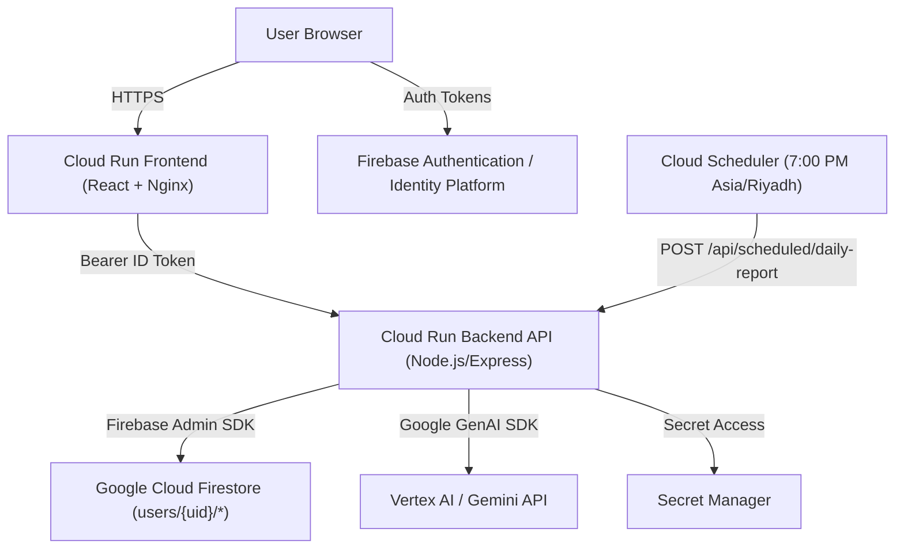

# Google Cloud Architecture Overview — Masar AI (مسار AI)

## Target Google Cloud Architecture Diagram

---

## Component Specifications & Responsibilities

### 1. Cloud Run Frontend (`masar-ai-frontend`)
- **Technology**: React 19 + Vite compiled into static assets served via Nginx Docker container.
- **Security**: No private server credentials baked into bundle. Uses `VITE_FIREBASE_*` public client keys.

### 2. Firebase Authentication
- **Role**: Credential authority and ID Token issuer (Email/Password, Google OAuth).
- **Security**: Issues JWT Bearer tokens with 60-minute rotation.

### 3. Cloud Run Backend API (`masar-ai-backend`)
- **Technology**: Node.js, Express, TypeScript.
- **Role**: Secure API gateway, Firestore data controller, AI prompt orchestration, rate limiting, and CORS enforcement.
- **Multi-Tenant Security**: Enforces Firebase Admin SDK `verifyIdToken()` and scopes all data mutations under `userId: uid`.

### 4. Cloud Firestore
- **Role**: Primary document storage database.
- **Hierarchy**:
  - `users/{uid}/applications/{appId}`
  - `users/{uid}/tasks/{taskId}`
  - `users/{uid}/reports/{reportId}`
  - `users/{uid}/jobRecommendations/{jobId}`
  - `users/{uid}/preferences/dailyReport`
